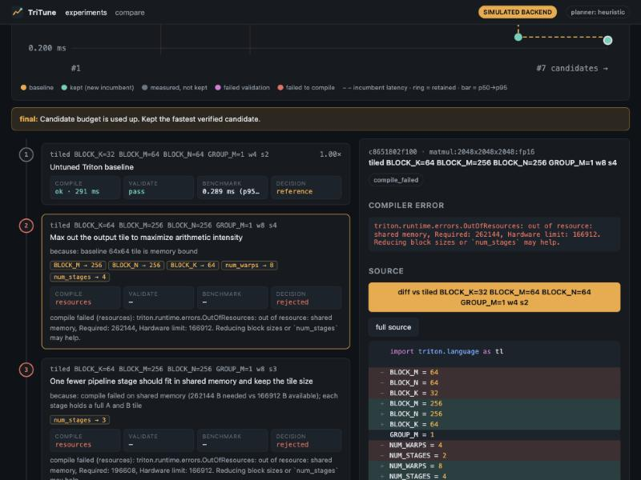
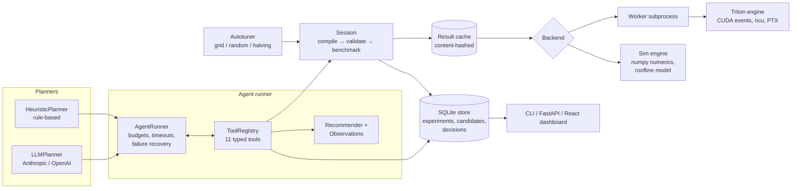
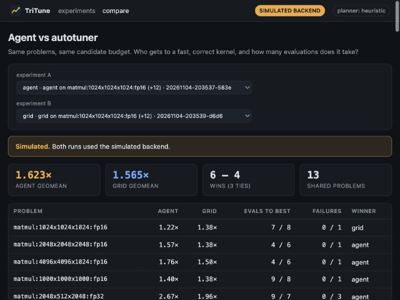

# KernelPilot

KernelPilot is a workbench for optimizing Triton GPU kernels with an agent that has to *earn* every change.

The agent doesn't write a kernel and hope. It reads compiler metadata (registers, spills, shared memory), profiler counters and PTX, forms one hypothesis at a time, generates a candidate, compiles it, checks it against an fp64 reference, benchmarks it, and keeps it only if it beats the current best by more than measurement noise. Every step is stored in SQLite, so any change in the final kernel can be traced back to the measurement that motivated it.

Running alongside it is a plain deterministic autotuner (grid / seeded random / successive halving) with the same budget. The comparison between the two is the main point of the project: does compiler feedback actually buy you anything over brute force?



*The trace view for the `compile-failure` demo. The first idea (256x256x64 tiles, 4 stages) blows the shared memory limit, the agent reads the `OutOfResources` numbers, steps the footprint down, and ends up 1.32x over the baseline. Simulated backend, see below.*

> **A note on numbers.** I developed this on a Mac, which has no CUDA and no Triton wheels. All numbers in this README come from the **simulated backend**: numerics are emulated for real on the CPU, but timings come from an analytic model. They are labelled as simulated everywhere they appear (CLI, reports, dashboard). The real Triton path is implemented and has its own test file (`tests/test_gpu.py`) that runs on a CUDA machine, but I haven't published hardware numbers I can't stand behind.

## What's interesting here

- **Real compiler feedback in the loop.** Compile errors, `CompiledKernel` metadata (`n_regs`, `n_spills`, `shared`), PTX (vectorized loads, `ld.local`, `mma`, `cp.async`) and Nsight Compute counters are turned into structured observations (`analysis/observations.py`) that the agent reasons over. "149 registers spilled" becomes `{"kind": "spills", "n_spills": 149, "n_regs": 255}`, and the hypothesis that follows cites it.
- **Correctness gates performance.** Nothing gets benchmarked until it passes validation against a float64 reference on the target shape *and* ragged edge shapes. A candidate that produces NaNs is never timed and can never be "the fastest".
- **Noise-aware acceptance.** A candidate replaces the incumbent only if its p50 improves by more than `max(1%, half the p50→p95 spread)`. This stops the agent from chasing jitter.
- **Same pipeline for everyone.** The agent (heuristic or LLM), the autotuner and the CLI all evaluate candidates through one `Session`, so the numbers are directly comparable.
- **Fails safely.** Candidate code runs in a worker subprocess with a timeout, a CPU rlimit and a scrubbed environment. Bad kernels can hang or crash the worker without taking the run down. (This is crash isolation, not a security sandbox. More on that below.)
- **Works with no GPU and no API key.** The heuristic planner needs no LLM, and the simulated backend lets the whole workflow run on a laptop and in CI.

## Architecture



| module | what it does |
|---|---|
| `kernels/` | Kernel specs for vector add, softmax, reduction and tiled matmul: Triton source templates, numpy references, search spaces, the untuned baseline, launch constraints and resource estimates |
| `analysis/static_check.py` | AST checks on candidate source: non-power-of-two `tl.arange`, `tl.*` functions that don't exist, numpy calls inside `@triton.jit`, `break`, undefined names |
| `backends/triton_engine.py` | Real compile/validate/benchmark/profile. Runs in the worker process |
| `backends/sim_engine.py`, `perf_model.py` | Simulated backend: numerics emulated in numpy, timing from a roofline-ish model plus seeded noise |
| `backends/isolation.py` | Subprocess executor with timeouts and rlimits |
| `cache.py` | Content-addressed result cache |
| `session.py`, `store.py` | Evaluation pipeline and SQLite persistence |
| `tuner.py` | Deterministic search strategies |
| `agent/` | Tools, recommender, planners, runner, LLM providers |
| `report.py`, `analysis/compare.py`, `analysis/trace.py` | Reports, experiment comparison and the trace assembly behind the dashboard |
| `server.py`, `dashboard/` | FastAPI backend and React/TypeScript dashboard |

## Install

```bash
git clone https://github.com/rimjhimsingh2107/kernelpilot.git
cd kernelpilot
python -m venv .venv && source .venv/bin/activate
pip install -e ".[dev]"            # CLI, server, tests
pip install -e ".[gpu]"            # torch + triton, on a Linux box with an NVIDIA GPU
pip install -e ".[anthropic]"      # optional, for the LLM planner
```

Check what you've got:

```bash
kernelpilot doctor
```

On a machine without CUDA it'll tell you torch/triton/driver are missing and that it'll use the simulated backend.

Dashboard (Node 20+):

```bash
cd dashboard && npm install && npm run build && cd ..
kernelpilot serve      # http://127.0.0.1:8000
```

For dashboard development, run `kernelpilot serve` and `npm run dev` in `dashboard/` (Vite proxies `/api` to port 8000).

## Quick tour

```bash
kernelpilot demo                                  # five scripted-opening scenarios, ~10 s, simulated
kernelpilot list                                  # operators, variants, suites
kernelpilot test softmax --all-variants           # correctness of every variant, including the broken ones
kernelpilot benchmark matmul --shape 2048x2048x2048 --dtype fp16
kernelpilot optimize softmax --strategy agent --shape 1024x16384 --dtype fp32
kernelpilot optimize matmul --strategy grid --budget 16
kernelpilot bakeoff --suite standard --budget 8   # agent vs grid vs random, same budget
kernelpilot compare                               # latest agent run vs latest autotuner run
kernelpilot report --format all                   # md + html + json into ./reports
kernelpilot runs                                  # experiment history
```

Every command takes `--backend auto|triton|sim`. `auto` uses Triton when torch, triton and a CUDA device are all present, and the simulator otherwise.

### The demo

`kernelpilot demo` runs five scenarios end to end through the normal planner, tools, session, store and report code. The only scripted part is the *first* candidate in four of them, which forces the agent into a specific mistake so you can watch it recover:

| scenario | what happens |
|---|---|
| `success` | 16K-wide softmax spills registers with 4 warps. The agent sees the spill count in the metadata and doubles warps until the spills are gone. Then it's compared against grid search |
| `invalid-kernel` | Opening move drops the max subtraction and keeps `exp()` in fp16. Validation finds 67K NaNs, the candidate is rejected without being timed, and the next hypothesis is the overflow-safe online variant |
| `compile-failure` | 256x256x64 tile with 4 stages needs 256 KB of shared memory. The `OutOfResources` message is parsed into `{required, limit}` and the agent removes stages, then shrinks tiles |
| `bad-source` | A hand edit sets `BLOCK_M = 96`. Static checks flag `tl.arange(0, 96)` and the agent rounds it to a legal size |
| `regression` | Opening move compiles and validates but runs 2.2x slower. It's rejected and the agent continues from the previous incumbent |

Markdown and HTML reports for each scenario land in `reports/demo/`.

## How the agent works

The loop is Observe → Hypothesize → Modify → Compile → Validate → Benchmark → Analyze → repeat, and it's driven entirely through tools:

| tool | |
|---|---|
| `inspect_kernel` | source, launch config, variants, search space |
| `generate_candidate` | new candidate from a base: change variant/params/warps/stages, or supply full source. Requires a hypothesis. Spends budget. Duplicates are detected by source hash and don't cost anything |
| `compile_candidate` | compiler errors or resource metadata |
| `validate_correctness` | fp64 reference on target + edge shapes |
| `benchmark_candidate` | p50/p95, speedup vs baseline, accept/reject vs incumbent |
| `inspect_compiler_metadata` | registers, spills, shared memory, occupancy estimate, derived observations |
| `inspect_ptx` | PTX summary (real backend only; the simulator says so instead of making something up) |
| `profile_candidate` | Nsight Compute counters (or simulated ones, labelled) |
| `compare_candidates` | side-by-side table |
| `recommend_optimization` | the rule-based advisor (below) |
| `save_experiment` | finish with a summary |

Inputs and outputs are pydantic models, so the same definitions produce JSON Schema for the LLM and validation for every call. Bad arguments, unknown tools, missing candidates and tool exceptions come back as error results rather than crashing the run.

**Budgets and failure handling.** The runner enforces a candidate budget, a step budget and a wall-clock budget, stops after N consecutive failed tool calls or an idle planner, and gets a few grace steps after the candidate budget runs out to finish evaluating what it already generated. Whatever happens (planner exception, API outage, budget exhaustion) it calls `save_experiment` itself and keeps the best *verified* candidate. Backend calls have their own per-job timeout in the worker.

**The recommender** (`agent/recommender.py`) is deliberately boring: a set of rules that map observations to concrete config changes, each with a hypothesis and the evidence that triggered it. Repairs come first if the last candidate failed:

| observation | suggested change |
|---|---|
| `OutOfResources` (shared memory) | drop a pipeline stage, halve `BLOCK_K`, shrink the larger tile dim |
| non-power-of-two extent | round to the nearest legal size |
| NaN/Inf in output | restore the max subtraction / switch to online softmax |
| tolerance failure with fp16 accumulator | accumulate in fp32 |
| tail-only mismatch | put the bounds mask back |
| spills / register pressure | more warps, smaller tile, chunked online softmax |
| low occupancy limited by shared memory | fewer stages |
| small matmul tile | 128x128 with 8 warps |
| row-major tile order with wide N | grouped ordering (`GROUP_M=8`) for L2 reuse |
| shallow pipeline / latency bound | one more stage |
| thousands of same-address atomics | fold more tiles per program, or two-pass |
| nothing specific | one-step local search, parameters that already paid off first |

Changes that already measured slower are not suggested again, and configs that were already evaluated are filtered out.

**Planners.** `HeuristicPlanner` follows the recommender and needs no API key. `LLMPlanner` gets the same tools and can use the recommender as a second opinion or ignore it. Set `KP_LLM_PROVIDER=anthropic` (default model `claude-opus-5-5`, uses the official SDK; server-side refusal fallback on by default, `KP_ANTHROPIC_FALLBACKS=0` to turn it off) or `KP_LLM_PROVIDER=openai` with `KP_LLM_MODEL`. `--planner auto` picks the LLM if one is configured and falls back to the heuristic planner otherwise.

## The deterministic autotuner

- **grid**: walks the full cartesian space with an even stride when the budget is smaller than the grid. Plain truncation would only ever see the first variant and the smallest tiles.
- **random**: seeded sampling without replacement (`--seed` / `KP_SEED`).
- **halving**: successive halving. Every config gets compiled and validated once and timed with a few reps; the best 1/η (η=3) are re-timed with η× more reps until one is left or the rep cap is reached.

All three exclude the baseline config, deduplicate, and pick the winner purely by measured p50 among verified candidates.

## Agent vs autotuner

Standard suite (13 problems: 5 matmul, 5 softmax, 3 reduction, mixed dtypes, including ragged shapes), budget of 8 candidates per problem, seed 0. **Simulated backend.**

| | geomean speedup | candidates evaluated | compile failures |
|---|---:|---:|---:|
| agent (heuristic planner) | **1.62x** | 100 | 0 |
| grid | 1.57x | 117 | 7 |
| random | 1.49x | 117 | 1 |

Head to head: agent beats grid on 6 problems, loses on 4, ties on 3; against random it's 5-4 with 4 ties.

| problem | agent | grid | random | evals to best (agent / grid) |
|---|---:|---:|---:|---:|
| matmul 1024³ fp16 | 1.22x | **1.38x** | 1.29x | 7 / 8 |
| matmul 2048³ fp16 | **1.57x** | 1.38x | 1.12x | 4 / 6 |
| matmul 4096x4096x1024 fp16 | **1.76x** | 1.50x | 1.27x | 4 / 6 |
| matmul 1000³ fp16 | **1.40x** | 1.38x | 1.30x | 9 / 8 |
| matmul 2048x512x2048 fp32 | **2.67x** | 1.96x | 1.64x | 9 / 7 |
| softmax 4096x1024 fp16 | 1.00x | 1.00x | 1.00x | 1 / 1 |
| softmax 8192x512 fp16 | 1.00x | 1.00x | 1.00x | 1 / 1 |
| softmax 2048x4096 fp32 | **1.51x** | 1.39x | 1.39x | 4 / 3 |
| softmax 1823x781 fp16 | 1.00x | 1.00x | 1.00x | 1 / 1 |
| softmax 1024x16384 fp32 | 8.24x | 8.33x | 8.33x | 4 / 9 |
| reduction 1M fp32 | 1.24x | **1.29x** | 1.29x | 7 / 3 |
| reduction 16M fp32 | 1.63x | 1.59x | 1.64x | 6 / 7 |
| reduction 4M+7 fp16 | 1.72x | 1.82x | **1.86x** | 4 / 7 |

What I take from this, with the caveat that it's a model and not a GPU:

- The agent's edge is on matmul, where the observations map cleanly to known-good moves (bigger tiles, grouped ordering, deeper pipelines). It reaches its best in fewer evaluations and never wastes a trial on a config that can't fit in shared memory; grid spends 7 of its 117 trials on compile failures.
- On the small softmaxes there's nothing to find. The agent notices that and stops early (5 evaluations instead of 9), which is why it used 100 candidates against 117.
- On reductions, random search does as well or better. The interesting configs there (big `TILES`, particular block sizes) are a fairly flat region that random sampling hits easily, and the agent's one-step local search is slower to wander across it.
- A small 1-2% gap is within what the noise threshold treats as a tie. Don't over-read single-problem differences.

Reproduce with `kernelpilot bakeoff --suite standard --budget 8 --backend sim`. On real hardware, drop `--backend sim` and the same command produces measured numbers. The full report for the agent run is in [docs/example-report.md](docs/example-report.md).



## Correctness

- References are float64: numpy for the simulator, PyTorch on-device (`torch.softmax`, `@`, `sum` in fp64) for the Triton backend.
- Each candidate is checked on the target shape plus two small awkward shapes per operator (e.g. `5 x (N-3)` softmax, `17x33x47` matmul) so masking bugs can't hide behind nicely divisible sizes.
- The check is `|out - ref| <= atol + rtol * |ref|`, with tolerances per op and dtype. Matmul scales `atol` with `sqrt(K)`; fp32 matmul allows for tf32 since `tl.dot` uses it by default. Reductions are tight (rtol 2e-5) for both dtypes because the accumulator must be fp32 either way.
- Results include max abs/rel error, mismatch fraction, NaN/Inf counts and the worst index.
- Inputs are generated from `(seed, shape, dtype)`, so every run sees the same data.
- Some variants are broken on purpose (`unmasked` add, `naive` softmax, fp16-accumulator matmul and reduction). They're excluded from autotuner search spaces and exist so the failure paths get exercised for real. `kernelpilot test softmax --all-variants` shows them failing.

In simulated mode, validation runs on a reduced shape for big problems (matmul dims capped at 1024 plus the original remainder mod 64, softmax rows capped at 2048) to keep CPU emulation fast. The check records which shape it actually ran.

## Benchmarking

- Timing uses CUDA events around each launch, with a 256 MB buffer zeroed between reps to flush L2 (same idea as `triton.testing.do_bench`), after a configurable warmup (`KP_WARMUP`, default 10; `KP_REPS`, default 50).
- Reported: all samples, p50, p95, mean, std, min, max.
- Compile time is the first launch minus a warm launch, with a fresh `TRITON_CACHE_DIR` per job so Triton's own cache doesn't hide it.
- Speedup is always relative to the **untuned Triton baseline**: the straightforward config you'd write from the Triton tutorials (`BLOCK_SIZE=1024` / `num_warps=4` for elementwise and reduction, whole-row single-pass softmax with 4 warps, 64x64x32 row-major matmul with 2 stages). It's defined in each spec's `baseline()`.
- Geomean speedup only includes problems where both the baseline and the best candidate passed validation. The report says how many problems that is.
- Profiling uses `ncu --csv --page raw` with a fixed metric list (DRAM/SM throughput, achieved occupancy, registers, shared memory, duration). If `ncu` isn't installed or lacks counter permissions, profiling reports that instead of returning zeros. Only metrics the toolchain actually produced are shown.

## Caching

Compile, validate, benchmark and profile results are cached in the same SQLite file under a SHA-256 key of:

```
stage + candidate source hash + problem (op, shape, dtype) + stage knobs (seed, warmup, reps)
      + environment fingerprint (backend, GPU name, compute capability, driver, CUDA, torch, triton, kernelpilot version)
```

Change the GPU, upgrade Triton or edit one character of the kernel and you get a miss. Timeouts and crashes are never cached since they might be transient. `kernelpilot cache` shows stats, `kernelpilot cache --clear` wipes it, `KP_CACHE=0` disables it.

## Experiment database

`.kernelpilot/kernelpilot.db` (override with `KP_HOME` / `KP_DB`) has three main tables:

- `experiments`: strategy, target problems, params (budget, seed, reps, planner), full detected environment, the cache fingerprint, and the final summary
- `candidates`: source and hash, config, parent, origin, every compile/validation/benchmark/profile result including raw timing samples, status, speedup, and whether it was retained
- `decisions`: the ordered log of what the optimizer did: planner thoughts, every tool call with arguments and (truncated) results, hypotheses with their evidence, accept/reject verdicts with the numbers behind them, and the final summary

So for any retained candidate you can walk back: which hypothesis produced it, which observation that hypothesis cited, and which candidate's metadata or profile the observation came from.

## Reproducing an experiment

Each report ends with the params and environment fingerprint. To rerun:

```bash
KP_SEED=0 KP_REPS=50 KP_WARMUP=10 kernelpilot bakeoff --suite standard --budget 8
```

The simulated backend is fully deterministic: same seed, same results, bit for bit. On hardware the inputs and the search order are deterministic but timings vary run to run, which is what the noise threshold is for. The heuristic planner is deterministic given the same measurements. LLM planners are not.

## Configuration

| variable | default | |
|---|---|---|
| `KP_BACKEND` | `auto` | `auto`, `triton` or `sim` |
| `KP_HOME` | `.kernelpilot` | where the database lives |
| `KP_DB` | `$KP_HOME/kernelpilot.db` | |
| `KP_ISOLATION` | `subprocess` for triton, `inprocess` for sim | |
| `KP_TIMEOUT` | `120` | seconds per worker job |
| `KP_SEED` / `KP_REPS` / `KP_WARMUP` | `0` / `50` / `10` | |
| `KP_CACHE` | `1` | |
| `KP_LLM_PROVIDER` / `KP_LLM_MODEL` | `none` | `anthropic` or `openai` |
| `KP_NCU` | found on PATH | path to Nsight Compute |
| `KP_LOG_LEVEL` / `KP_LOG_JSON` | `WARNING` / `0` | structured logs to stderr |

## Testing

```bash
pytest                  # ~95 tests on the simulated backend, a few seconds
pytest -m gpu           # real hardware tests, skipped without CUDA
ruff check src tests && ruff format --check src tests
```

The suite covers the kernel specs and references, static checks, PTX and ncu parsing (against fixtures), the simulated backend, subprocess isolation (timeouts, hard crashes, secret scrubbing), the cache, the store, every search strategy, the agent (spill fixing, numerical repair, shared memory repair, regression rejection, budgets, duplicates, tool errors, an LLM planner driven by a scripted fake provider, planner crashes, idle planners), the CLI, the API and all five demo scenarios. CI runs it on Python 3.10 and 3.12, builds the dashboard, and has an opt-in job for a self-hosted GPU runner.

## Limitations

- **No hardware numbers yet.** See the note at the top. The Triton engine follows Triton 3.x conventions and probes `CompiledKernel` fields defensively, but it hasn't been run against every Triton release.
- **The performance model is a toy.** It moves in the right direction for the things it models (tile reuse, occupancy, spills, atomics, padding, L2 reuse for grouped matmul) and knows nothing about bank conflicts, instruction scheduling, TMA, Hopper wgmma or real cache behaviour.
- **The search spaces are template-based.** The agent can submit arbitrary source, and the real backend will compile and validate it, but the simulator can only emulate kernel bodies it recognizes from the templates (others come back "unverified", never "passed").
- **Isolation is not a sandbox.** The worker runs as your user with your filesystem and network. It protects the run from crashes and hangs, not you from malicious code. Don't feed it source you wouldn't run yourself.
- **Static checks are heuristics.** On the real backend they're only warnings; Triton has the final word.
- **Noise handling is a heuristic too**, not a statistical test.
- **Four operators.** Enough to exercise elementwise, row-wise, reduction and compute-bound patterns; not a kernel library.

## Things I'd like to add

- Measured results on an A100 / H100, and an LLM-planner column in the comparison table
- Flash-attention style fused kernels, where structural changes matter more than launch params
- A Bayesian optimization baseline next to grid/random/halving
- Proper statistical testing (bootstrap CIs or Mann-Whitney) for accept/reject
- Containerized workers for actual sandboxing
- Feeding ncu source-level counters (stall reasons) into the observations

## License

MIT
